# AimTuner

An aim benchmark and trainer in a 3D arena, for a controller or for mouse and
keyboard. Seven things in one program:

| | What it is for |
|---|---|
| **Core track** | Nine scenarios of raw aim with no assistance. Every run is logged under the controller you played it on, and the app tells you which pad is actually doing better - and whether the gap is real or just noise. |
| **Call of Duty track** | 27 scenarios on Call of Duty's own sensitivity scale, with its response curves, aim assist, movement and a 5-body-shot rifle. Three drills for each of nine mechanics. |
| **Siege track** | 24 scenarios built on Rainbow Six Siege: its sensitivity and field of view, nine real guns each with its own recoil, one-bullet headshots, soft walls you shoot through, leaning. Three drills for each of eight skills. **No aim assist for anyone**, as in the game. |
| **Progress and training** | Your own runs over time on one controller - best, last three, improving or slipping - and a playlist built from the five scenarios where you are losing the most. |
| **Guided comparison** | The fair way to compare two controllers: a warm-up, then passes in A - B - B - A order with the screen telling you which pad to pick up, and a verdict that says whether the gap is real. |
| **Controller lab** | A one-minute speed test of the pad itself: report rate and jitter, stick rest position, range, resolution and snap-back, button and trigger timing. |
| **Sensitivity finder** | Plays blind blocks at different sensitivities and fits a curve through your scores to find the value you play best at - stick sensitivity first, then the ADS multiplier. On a mouse it searches centimetres per turn instead. |

Built to compare the GameSir Tarantula 8K against the G7 Pro 8K, but profiles are
just names: add as many pads as you like. It is not a Call of Duty app or a Siege
app - those are tracks, and the Core track stays exactly what it was.

Every track can also be played on **mouse and keyboard**: raw mouse input on its
own thread, no acceleration or smoothing, clicks timed to a fraction of a
millisecond - and **no aim assist of any kind on a mouse, on any track**. See
"Mouse and keyboard" below.

Each track words sensitivity its own way, and **you can have one sensitivity for
all of them**: tell the controller to follow one track's settings and the mouse
to follow another's, and every track turns that way. See "One sensitivity for
every track".

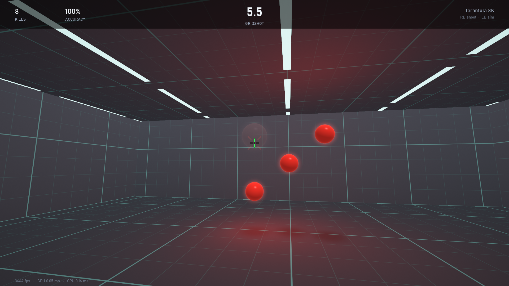

## Get it (Windows)

1. Download **AimTuner.zip** from the [latest release](../../releases/latest).
2. Unzip it anywhere (keep `AimTuner.exe` and the `_internal` folder together).
3. Double-click `AimTuner.exe`. Windows may say it "protected your PC" because the
   exe is not signed: **More info -> Run anyway**.

No Python needed. It sets itself up for your PC on first launch: fullscreen at
your desktop resolution, **Low graphics**, and a **frame cap one frame under your
monitor's real refresh rate** (read from Windows to the hundredth: a "240 Hz"
screen running 239.99 Hz gets 238, 180 Hz gets 178-179, 360 Hz gets 358). Your
mouse's DPI is read automatically where the mouse can report it (Razer and
others; set it by hand in Settings otherwise). Two controller profiles and a
mouse-and-keyboard profile are ready - rename them under Input devices. All of
it can be changed in Settings; your settings and runs stay in that folder
(`config.json`, `logs/`).

Needs Windows 10 or 11 and a graphics card with OpenGL 3.3 (anything from the
last decade).

## Run it

**AimTuner.exe** (or the AimTuner shortcut on the desktop) - fullscreen, no
Python needed. It uses the `config.json` and `logs/` in this folder, the same
ones as running from source. The `_internal` folder beside it holds its copy of
Python and the libraries: the two go together, so move or copy them as a pair.

```
AimTuner.exe            fullscreen at the desktop resolution / refresh rate
build_exe.bat           rebuild AimTuner.exe after the code has changed (about 30 s)
run.bat                 the same game from source, with Python
run.bat --windowed      in a window
analyze.bat             print the controller comparison from the logs
```

The exe takes the same command-line options as `python app.py` (`--windowed`,
`--selftest`, ...); having no console, it prints to `aimtuner.log`. It is built as
an exe plus a folder rather than one self-contained file because a single file
unpacks itself on every launch: 3.1 s to open here, against 1.1 s.

Running from source, the first launch installs four small packages (`glfw`,
`PyOpenGL`, `numpy`, `pillow`).

Menus work from the pad (D-pad or left stick, **A** select, **B** back) or the
keyboard (arrows, Enter, Esc) or the mouse: the pointer shows in every menu
(it is hidden only over a run), pointing at a line selects it, a left click
presses it, a right click goes back, the wheel scrolls, and the hints along the
bottom ("Esc  back", "Enter  play") are buttons too. **Start** or **Esc** pauses
a run. **F11** toggles fullscreen, **F12** saves a screenshot to `logs/shots`.

Any number in Settings can be typed: on a number line just type it (or press
Enter, or click the line, and type), then Enter to set it, Esc to cancel.
Clicking another line or moving off it keeps what was typed. A value outside the
setting's range is kept at the nearest end, and says so. Into a percentage
(the Core deadzone) "8" means 8 %. The ‹ › either side of a selected value are
buttons as well.

### Endless

On any track, highlight a scenario and press **Y** to play it **endless**: no
clock, and for Reflex and Stick Snap no trial count - targets keep coming until
you stop. **Start / Esc** pauses as usual; from the pause menu **B / Esc**
finishes it and shows the session's numbers (A plays it endless again, X
restarts). The top of the screen counts up how long you have played.

It is practice, not a measurement: a twenty-minute run cannot be set against
45-second ones, and its totals (kills, score) grow with its length. So endless
runs go to `logs/endless.jsonl` and never into `runs.jsonl` - your averages,
Progress, the training picks, Compare and `analyze.py` do not see them. Every
scenario keeps spawning indefinitely (checked by bots on all 60, and in
two-and-a-half-minute runs of ten of them, over three normal rounds each).

## The ghost: your run, replayed against a strong human

Every run you play (timed or endless, every drill with aiming in it) is
captured, and as soon as it ends a **ghost** - a strong human player, built from
published research on human aiming - plays **the very same targets**. On the
results screen:

- a **GHOST** column beside your numbers, on the drill's own metrics;
- **one line of coaching**: where the biggest gap is and what it is made of
  ("Your biggest gap is corrections: 210 ms a target against the ghost's 90 ms.
  Your first movement leaves 30% of the way still to go and you need 1.4
  corrections; the ghost's leaves 15% and needs 0.6.");
- **Y - replay with the ghost**: your run again in first person, with the
  ghost's crosshair (teal) and both aim trails drawn over it. On each target the
  ghost's crosshair is placed against that target as it was the same moment
  after the target appeared in the ghost's run, so you see how it would have
  come in. Left / Right skip 2 s, LB / RB jump between targets, Up / Down change
  the speed (down to a quarter), **Y jumps to the next target where you lost the
  most time**, X switches to the ghost's own view of its own run;
- **X - every target**: each target you both killed, with your time, the ghost's
  and the difference; the **route** - both crosshairs seen from the target, closing
  in on it (dots every 50 ms bunch where you were slow; the dashed line is the
  straight way in); and the time split into reaction, first movement,
  corrections, getting the shot off and finishing it (on a moving target:
  getting on it, then staying on it - how much of the time you were on it while
  firing, and how many bullets landed). A on a target plays it in the replay.

### "The same scenario"

The ghost's world holds the run's own targets, in the run's order, moving along
the paths they took. They come in at the ghost's pace: when it kills one sooner
than you did, the next arrives sooner, after the same gap you had (and no more
are up at once than you had). If it gets through all of your run's targets
before the time is up, it starts on them again. Its body is yours - it stands,
walks, leans and crouches exactly as you did relative to each target - and only
its hands are its own: the aim stick (or mouse), the trigger and the sights. It
plays through the game's real code: your sensitivity, curve, deadzones and
settings, the same aim assist (Call of Duty track, controller only - never on a
mouse, never on Siege), recoil, damage, and dummies that fire back.

Where the ghost is slower than you on a target, it has to keep going past the
end of the path you saw: a strafer or runner keeps going back and forth along
it; one that peeked, crouched, rushed or stood stays where you killed it.

### How it aims, and where the numbers come from

It is a model of human aiming, not an aimbot. Marked [R] where the number comes
from research, [A] where nothing is published and it is assumed:

| | Controller | Mouse | |
|---|---|---|---|
| Reaction to a new target | 185 ms | 180 ms | [R] top-quartile visual reaction (Woods 2015), helped a little by a drill's rhythm |
| Seeing is delayed by | 85 ms | 80 ms | [R] smooth-pursuit latency 100-130 ms (Frontiers in Systems Neuroscience review, 2013) |
| First movement | ~0.06 + 0.07 x bits s | ~0.04 + 0.06 x bits s | [R] Fitts' law; a stick has about half a mouse's throughput (Natapov 2009, Ramcharitar 2017) |
| ...speed profile | peaks at 40% of the movement | | [R] Burkitt et al. |
| ...where it lands | 6% short, spread 13% of the distance along / 6% across | 5% short, 11% / 5% | [R] lands short, spread along 2.3x across (Burkitt; Warburton 2023) |
| Corrections | ~110-120 ms after landing | | [R] Brenner & Smeets 1997; ~0.6 a target on Flick (research: 1.2-1.8 movement segments a target, Boudaoud 2022) |
| Following a moving target | gain 4.3 /s | 4.8 /s | [R] crossover frequency for rate / position control (McRuer & Jex) |
| ...a change of direction | answered in ~165 ms | ~145 ms | [R] 190-200 ms for unpredictable reversals (Kelkkanen 2023) |
| Firing | as the crosshair arrives | | [R] skilled players click early, 13-24% into the target (Park & Lee 2020) |
| Trigger finger | 40 ms | 30 ms | [A] |
| Thumb / hand | stick lags 25 ms, full sweep in ~70 ms, bows in an arc, 9 Hz tremor | top hand speed 150 cm/s, 9 Hz tremor | [R] tremor 8-11 Hz, fast hand speed 0.9-1.7 m/s; the rest [A] |
| Recoil | pulls down 55% (+/-20% burst to burst) of the gun's climb | 60% | [A] - nothing published |
| Aim assist | has learned it: leans on rotation and pushes through slowdown, 60% | none | [A] |

It also only sees its own aim the way you do: what its hand did, it knows at
once; what recoil, aim assist or its own shake did to the view, it sees on the
screen a moment later. That - not a cap on accuracy - is what makes it miss.

Measured on calibration runs (three seeds each), on a controller, against your
own averages from `logs/runs.jsonl` at the time of building it:

| Drill | Ghost | You |
|---|---|---|
| Flick, median time to kill | 557 ms, 93% accuracy | 680 ms, 93% |
| Micro Adjust | 455 ms | 579 ms |
| Gridshot | 2.4 kills/s | 2.0 |
| ADS Snap | 586 ms | 750 ms |
| Strafe Track | 63% on target, turns with it in 167 ms | 51%, 235 ms |
| Jump Shot (COD) | 913 ms first shot to kill, 49% accuracy | 1149 ms, 34% |
| Strafe Spray (COD) | 1154 ms, 41% | 1597 ms, 23% |
| Snap Shot (COD) | first hit 889 ms | 971 ms |
| 180 Check Six (COD) | first hit 1146 ms | 1154 ms |

On a mouse it is faster still (Flick 446 ms, Gridshot 2.9 kills/s). It is a
fixed level: as you get better it stays where it is, and the comparison will
start to say you matched it.

**Limits.** Thumbstick mechanics, recoil compensation and how far a player leans
on aim assist are not published; those numbers are assumptions. Most research is
on mouse and on average participants; "strong" here means the better quarter of
people where a study says so. The ghost is checked by bots for doing what a
human hand can (it never turns faster than the stick or a hand can, two runs of
it never come out the same), not by playing against people.

**Files.** `logs/captures/<run_id>.npz` holds a run's capture (about 1 MB for
45 s) and `<run_id>.ghost.npz` the ghost's; the newest 60 are kept and older ones
removed as new ones arrive (runs.jsonl is never touched). Runs from before 0.6.0
were not captured and have no replay.

## First-time setup (two minutes)

1. **Controller** - pick the profile that matches the pad in your hands and choose
   *Use this controller*. That links the pad's USB id to the profile; from then on
   plugging it in, or pressing a button on it while both pads are connected,
   switches profile automatically.
2. **Binds** - Shoot and Aim default to **RB / LB**. Select either row and press
   the button you want, or use the *bumpers* / *triggers* presets. *Trigger
   actuation* is how far RT/LT must travel to count as pressed.
3. **Settings** - set sensitivity, curve and deadzone once, then leave them alone
   while you test (see "Fair comparisons"). The Call of Duty track has its own
   block of settings there, on the game's scale.

## Core track

| Scenario | What you do | What it isolates |
|---|---|---|
| **Reflex** | Fire when the orb turns green (10 tries) | Shoot-button reaction: you + button/trigger travel + pad latency |
| **Stick Snap** | Throw the aim stick toward the arrow (16 tries) | Stick reaction and throw time (20% -> 90% deflection) |
| **Flick** | One target 12-40 deg away, snap and fire | Big throws, stopping on a point, overshoots, path efficiency |
| **Micro Adjust** | Small targets 2.5-9 deg off the crosshair | Fine control near stick centre (deadzone, tension, resolution) |
| **Gridshot** | Three targets always up | Rhythm and target-to-target speed |
| **Smooth Track** | Hold fire on a gliding target | Steady low-deflection control |
| **Strafe Track** | Hold fire on a target that reverses at random | Reactive tracking, reversal reaction time |
| **Spray Transfer** | Full-auto, 5 hits per target, three targets | Tracking under fire + switching |
| **ADS Snap** | Hold Aim, then fire; hip-fire doesn't count | Aim + Shoot binds together (LB+RB vs LT+RT) |

*Run the whole track* plays all nine back to back (about 9 minutes at 45 s rounds).
There is **no aim assist** here. What you measure is you and the hardware.

## Controller lab

Seven short captures, about a minute in all. While one is running the input
thread stops sleeping and records every state change the driver reports, with a
QueryPerformanceCounter timestamp, so intervals are resolved to a few microseconds.

| Step | What you do | What comes out |
|---|---|---|
| Sticks at rest (3 s) | Thumbs off | Where each stick rests and how much it wanders, how often the pad still reports while idle, and the lowest in-game **minimum deadzone** that swallows the resting value |
| Right / left rim (6 s each) | Roll the stick around its edge | **Report rate** and how evenly reports arrive (jitter, slowest 1%, worst gap) - measured here because a pad only reports when something changes; outer reach in every direction, circularity, the highest in-game **maximum deadzone** at which every direction still reaches full speed, and the stick's native resolution in bits |
| Snap-back (10 s) | Let the stick spring back from full deflection | How far it overshoots centre the other way, how long it takes to settle, and how fast you can throw it (10% -> 85%) |
| Shoot button (5 s) | Tap as fast as you can | Taps per second, press and gap lengths, contact bounces |
| Aim + shoot (8 s) | Press both at once | Which lands first and by how many milliseconds - the cost of your bind layout |
| Triggers (6 s, optional) | Pull and release | Analogue or digital, travel reached, pull time |

Results are shown beside the other controller's latest result and saved to
`logs/lab.jsonl` (`python analyze.py --lab` prints them).

What it cannot tell you is true press-to-PC latency. Software only ever sees
the moment a report *arrives*; measuring when the button was physically pressed
takes a hardware rig. Anything here is "what the PC receives, and how regularly".

## Call of Duty track

Everything in this track runs on a separate kit: the game's sensitivity scale, a
rifle with a time-to-kill, movement on the left stick, and aim assist. None of
it touches the Core track or its comparisons.

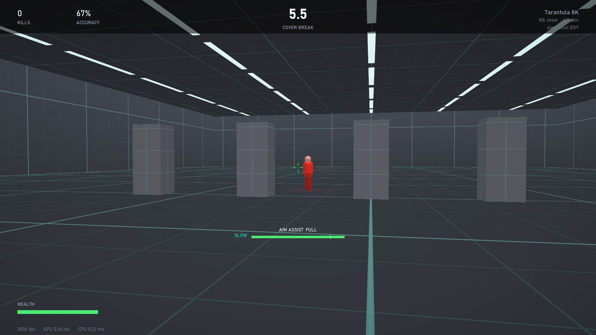

### Your settings, and the spin test

In *Settings -> Call of Duty track* you enter the same numbers you use in the
game: stick sensitivity 0.10 - 4.00 (horizontal and vertical), ADS multiplier,
response curve (Dynamic, Standard, Linear), min/max deadzones for both sticks,
FOV, and whether ADS FOV is Affected or Independent.

The game does not publish how many degrees per second a sensitivity number is, so
that part is **measured in your own game** rather than assumed. In a private
match, hold the right stick hard over and time a number of full spins with a
stopwatch - once from the hip, once aiming down sights - and type the numbers
into *Turn speed calibration*. From then on, full-stick turn speed here is your
real one at the sensitivity you measured it at, and other sensitivities scale in
proportion to the number.

The values that ship are from the spin test this was built with: 10 hip-fire
spins in 5.59 s and 5 ADS spins in 11.0 s at 1.95 sensitivity and x0.95 ADS,
which is 644 deg/s from the hip, 164 deg/s through the sights, and 330 deg/s per
1.00 of sensitivity.

### The rifle, movement and enemies

- One weapon: a full-auto rifle, 600 RPM. **5 body shots** kill at any range;
  headshots kill in **3 inside 30 m and 4 beyond**. That is a 400 ms body-shot
  time-to-kill - deliberately slower than the game's 312 ms for the rifle it is
  modelled on, so there is time to see what your aim is doing.
- Recoil follows a fixed pattern, as the game's does, with a little random
  wander on each bullet so no two sprays are identical. Its **shape** was read
  off a photo of an unheld full-magazine spray on the game's firing range:
  nearly straight up for six bullets, a kick to the right, a long lean to the
  left through the middle of the magazine, then back across to finish on the
  right. The photo cannot give the **size** (it does not say how far away the
  wall was), so that is set by feel: a five-bullet spray rises about 1.3
  degrees - chest to head at 20 m, over the head at 35 m - and a whole magazine
  about 9, drifting up to 0.9 degrees sideways on the way. There is no magazine
  to reload here; past 30 bullets the gun keeps climbing and sways about where
  it ended.

  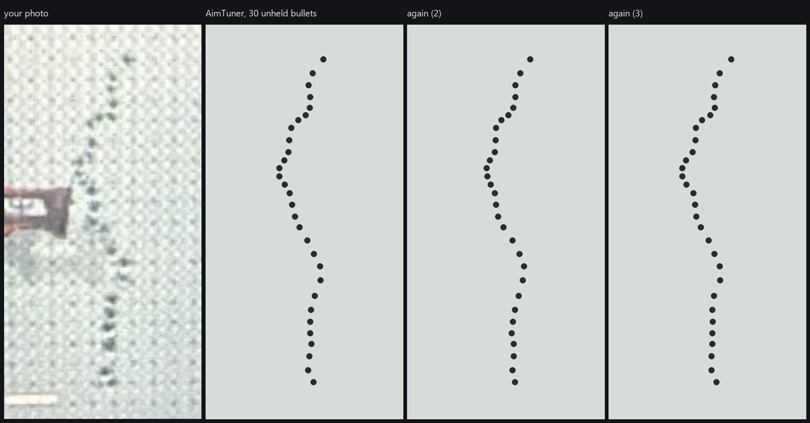
- No hip-fire drills: bullets from the hip spread, and every scenario expects
  you to aim down sights (250 ms to raise them, as the real rifle).
- Walk and strafe only (4.65 m/s, 2.95 m/s while aiming - the real rifle's
  speeds). No sprint, slide or jump.
- Some dummies shoot back. They are orange, fire after a short reaction delay,
  and hit much less often when you are moving across their aim. Each one gives
  itself away as it appears with a two-note warning tone, played in the ear on
  the side you need to turn to (both ears when it is in front of you). You have
  100 health that comes back after a few quiet seconds.

### Aim assist

Aim assist is a property of the **scenario**, never a setting: each one says
*assist* or *no assist* in the list, several pairs are the same drill with and
without it, and three exist to show you what takes it away. The only choice in
Settings is *which rule set* it follows: one of three games', or AimTuner's own.

What is modelled:

- **Slowdown** - while a target is inside a bubble around your crosshair, your
  look speed is cut.
- **Rotational** - the view turns by itself to follow part of the target's
  movement across your screen, whether it moved or you strafed. It needs stick
  input: left stick at least a quarter over *sideways*, or any right stick.
- Both need a clear line of sight, are cut by smoke, and fade out with distance
  (rotation long before slowdown).

The four rule sets have the **same strength**; they differ in how rotation is
earned and where it works:

| | Strafing alone, right stick untouched | Right stick following the target | Up close |
|---|---|---|---|
| **Black Ops 7** (default) | 75% of the rotation | all of it | fades in; full from about 12 m |
| **MW3 / Black Ops 6** | all of it | all of it | fades in; full from about 6 m |
| **Modern Warfare 4 (beta)** | almost none (15%) | all of it | no fade: full from point blank |
| **Coach** (AimTuner's own) | half | 65% - all of it only while strafing as well | fades in; full from about 6 m |

**Coach** copies no game. It is there to teach the mechanic rather than imitate
one title: rotation is paid out for three habits at once - the right stick
following the target (half of it), strafing (about a third), and keeping the
target in the middle of the bubble instead of riding its edge - and three small
bars under the meter (FOLLOW, STRAFE, CENTRE) show live which one is missing.
The results screen then says how much of each habit was there and which to work
on. It asks for more than any of the games do (the right stick has to supply
half the turn, where Black Ops 7 is content with a third), so someone who keeps
all three bars full is at full strength under every other rule set as well.

Following is judged as a habit, not a reflex. For the first 0.2 s after a target
is picked up, sets off or changes direction, the right stick is not judged at
all - nobody's thumb has reacted yet - and the assist carries on at whatever it
was. The stick is also averaged over about a tenth of a second, so quick taps
that keep up with a slow target count as keeping up, and a moment with nothing
to follow (neither of you moving) counts neither for nor against you. (The
first version judged every instant, and marked a real player down for reaction
time on every drill where targets stop or reverse.)

Modern Warfare 4 rules also follow a jumping target up and down as readily as a
side-step, where the other two follow vertical movement less. **That option is
built from the game's August 2026 beta, not the finished game**, which was not
out when it was written: Infinity Ward cut aim assist for the beta's second
weekend, said the result was not final, and published no numbers. What is known
is that the beta started with Modern Warfare II's aim assist, that after the cut
a target running past no longer turned the view unless the right stick was used,
and that the studio still found controllers slightly ahead inside 5 m. That the
right stick has to *follow* the target (rather than just be touched) is carried
over from Black Ops 7 as the likeliest reading. Expect it to need revisiting
after launch.

An **AIM ASSIST meter** under the crosshair shows OFF / WEAK / PARTIAL / FULL
live, and when it is not full it says why: *no stick input*, *follow it with the
right stick*, *too close*, *too far*, *off the target*, *no line of sight*,
*smoke* (under Coach rules the three habit bars take the place of that line). Each run also logs how much of your fight time was at full assist and
what cost you the rest.

It is **deliberately weaker than the real game**, as requested - strong enough
to learn the mechanic, not strong enough to lean on. The view follows 45% of a
target's motion against roughly 60% measured in the game, and slowdown removes
38% of look speed against roughly 50%. On the test the game itself has been
measured with - strafe past a still target at 10 m without touching the right
stick - the view turns 8.9 deg here against 19 deg in Black Ops 6, and 5.2 deg
against 11 deg in Black Ops 7: about half, with the same ratio between the two.

### The 27 scenarios

| Mechanic | Scenarios | Assist |
|---|---|---|
| **Flicking** | *Snap Shot* - one dummy 15-45 deg off your aim · *Target Swap* - three up, kill one and snap to the next · *Check Your Six* - they spawn beside and behind you, and shoot | off · on · on |
| **Tracking** | *Strafe Spray* - a strafing dummy at mid range · *Crossing Runner* - sprinting across your lane at 22-34 m · *Jump Shot* - strafing, jumping and crouching | off · on · on |
| **Micro-adjusting** | *Recoil Hold* - still dummies at 30-40 m, hold the spray on them · *Jiggle* - short quick side-steps at range · *Close Pair* - two dummies a few degrees apart | off · off · on |
| **Precision** | *Headhunter* - only headshots count · *Long Shot* - 45-58 m · *Head Glitch* - heads over cover, ducking in and out | off · on · off |
| **Aim assist** | *Slowdown Stop* - Snap Shot again, with assist · *Range Ladder* - the same fight at 4, 7, 10, 18, 30, 45 and 60 m · *Sticky Track* - Strafe Spray again, with assist | on |
| **Rotational aim assist** | *Strafe to Stick* - bullets only count while you strafe · *Mirror Strafe* - you strafe, it strafes · *Strafe Duel* - a one-on-one where standing still gets you killed | on |
| **Centering** | *Head Level* - is your crosshair already at head height? · *Corner Slice* - strafe out past a wall onto a dummy you cannot see yet · *Door Watch* - three doorways, hold a sensible angle | off · on · on |
| **First-shot** | *First Bullet* - one bullet each · *Snap ADS* - from the hip: sights up, one bullet · *Opening Burst* - win the first 0.4 seconds against a dummy that fires back | off · on · on |
| **Losing aim assist** | *Smoke Line* - a dummy strafing in and out of smoke · *Cover Break* - running behind a row of pillars · *Point Blank Push* - they charge, and assist fades as they close | on |

In the track list, **A** plays one scenario, **X** plays the three drills of that
mechanic back to back, and *Run the whole track* plays all 27 (about 26 minutes
at 45 s rounds). Each scenario has its own headline number - head-level error in
degrees, first-bullet hit rate, duels won, time back on target after cover - not
just a score.

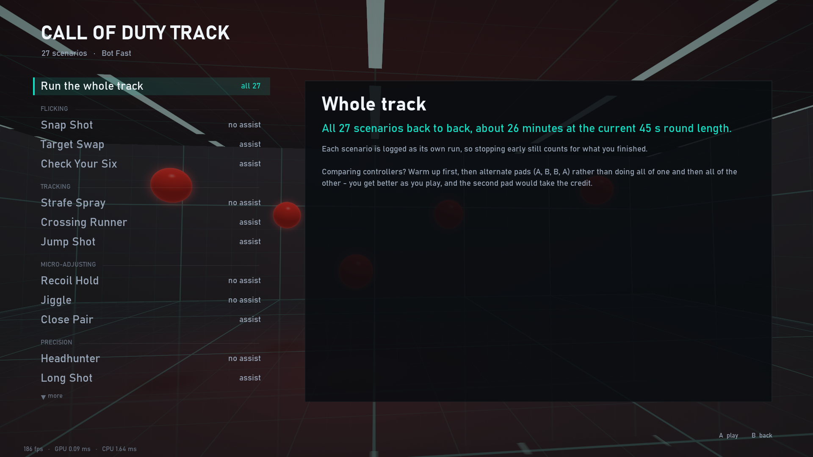

### How close is it to the real game?

| | Where it comes from |
|---|---|
| Full-stick turn speed, hip and ADS | **Measured** in your game (the spin test), at the sensitivity you timed it at |
| Turn speed at any other sensitivity or ADS multiplier | Assumed proportional to the number. Community timings suggest the 0.10 - 4.00 scale is close to linear, but the game does not say so. If you change sensitivity a lot, redo the spin test at the new value |
| Sensitivity scale, ADS multiplier, deadzones, FOV | The game's own settings |
| Rifle walk speeds, ADS time, first damage range; 100 health | Published weapon stats / patch notes (M15 MOD 0) |
| Black Ops 7: 75% rotation without right-stick tracking | Official patch notes (21 Nov 2025: penalty reduced from 35% to 25%) |
| Modern Warfare 4 rules | The August 2026 beta only: official notes say aim assist was reduced for the second weekend and is not final; everything about *how* it behaves comes from creators' footage and commentary, with no controlled measurements. The 15% figure is a stand-in for "almost none" |
| Response curve shapes | A community measurement of the game's three curves, read off a chart - close, not exact. One surprise in it: "Linear" is not linear, turn speed goes with roughly the square of stick travel |
| What counts as stick input, the on-screen bubble, where assist fades with distance | Community measurements (TheXclusiveAce and others) |
| How strong slowdown and rotation are | Tuned, then set below the game on purpose |
| Bubble size, what smoke and cover do to assist | Not published or measured anywhere - assumed |
| Recoil pattern | Shape: read off the player's photo of an unheld spray in the game. Size: tuned by feel, because the photo has no scale |
| Mouse: 0.0066 degrees per count per 1.00 of sensitivity; the Relative ADS formula | Third-party sensitivity calculators and their forums. The game does not publish either, and they were not checked against the game here |
| Hip-fire spread, how enemies shoot | Tuned by feel |
| Turn-speed ramp-up at full stick | **Not modelled.** The game speeds up over the first moments at full deflection; its size is not published. Here full stick is full speed at once, so the first instant of a big flick is quicker than in the game |
| Vertical turn speed | Assumed to scale exactly like horizontal; only horizontal was measured |

So: sensitivity at full stick is yours, mid-stick feel is a good approximation,
and aim assist follows the published rules at a reduced strength. It will not
feel identical to the game, and it is not meant to predict your in-game
accuracy - it is meant to train the same habits under the same rules.

## Siege track

Rainbow Six Siege's gunfight, as closely as its published numbers allow: close
indoor distances (Ubisoft's own figure for the average engagement is 10 m), a
head that is always one bullet, real guns with their own recoil, soft walls,
leaning - and no help aiming.

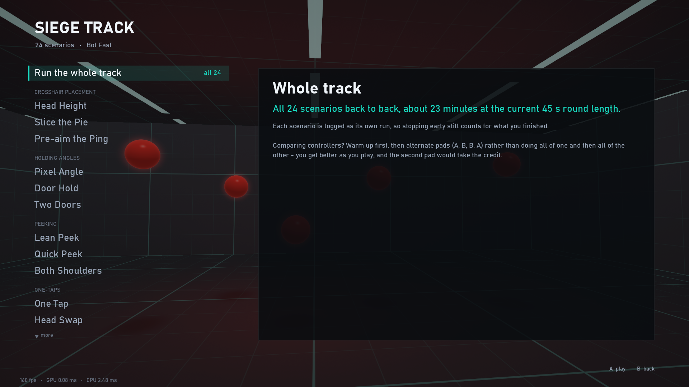

### No aim assist. None.

Siege gives a controller no aim assist in its multiplayer, so this track has
none: not on a controller, not on a mouse, not in any scenario, and not as a
setting you could turn on. It is locked away three times over:

- the track's kit (`r6kit.SiegeKit`) is built with the same stand-in a mouse
  gets on the Call of Duty track (`codkit.NoAssist`), whose `compute()` raises -
  and the kit never calls it, because it contains no slowdown or rotation code;
- a Siege scenario that declared aim assist would be refused the moment Python
  read its class (`SiegeScenario.__init_subclass__`);
- there is no aim-assist setting in the track's settings to change.

`tests/check_r6.py` checks all of it: with the sights up, the player strafing
and a moving dummy in the crosshair, the view does not move a hair on either
device, and a full-stick turn is exactly as fast on a target as off it.

### Guns and recoil

Nine guns, chosen under *Settings > Siege track > Gun*, easiest recoil first:

| Gun | Damage | Rounds a minute | Magazine | Character |
|---|---|---|---|---|
| UMP45 (Castle, Pulse) | 42 | 600 | 25 | next to no climb, a little wander |
| 556xi (Thermite) | 47 | 690 | 30 | gentle, drifting up and left |
| MP7 (Bandit) | 32 | 900 | 30 | bounces up at first, then random sideways; no grip |
| R4-C (Ash) | 39 | 860 | 25 | strong first kick, fast climb, steady pull right; worse from the 8th bullet |
| AK-12 (Ace, Fuze) | 40 | 850 | 30 | very strong first shot, then all over the place from the 10th |
| Vector .45 (Mira) | 23 | 1200 | 25 | nothing for three shots, then left and right |
| F2 (Twitch) | 37 | 980 | 25 | harsh vertical at the highest rifle fire rate |
| C8-SFW (Buck) | 40 | 837 | 30 | the hardest straight climb; no grip |
| SMG-11 | 32 | 1270 | 16 | a machine pistol: wild from the fifth round |

- **Damage, fire rate, magazines, damage drop-off and ADS times are the game's
  own**, as of Year 11 Season 3 (rifles lose damage from 25 m to 60% at 35 m,
  SMGs from 18 m to 28 m; a rifle's sights take 0.52 s, an SMG's 0.46 s, 5%
  faster on a 1x).
- **The recoil is built from how each gun is described, not from numbers** -
  nobody publishes Siege's recoil patterns as numbers, Ubisoft included. What is
  known is each gun's character: which climb hard, which way they drift, and
  (for a few) the bullet at which Ubisoft says the long-burst stage starts. The
  patterns here follow that, and the Settings screen draws the unheld spray for
  whatever gun, barrel and grip you pick. Treat it as the gun's character, not a
  copy. Recoil is the same on a controller and a mouse here; in the game the two
  are tuned separately, by amounts Ubisoft has not published.
- **Attachments do what they do in the game**: flash hider 20% less climb,
  compensator 35% less sideways kick, muzzle brake half the first bullet's kick;
  vertical grip 20% less climb, angled grip 20% faster reload, horizontal grip
  5% faster on your feet. The C8-SFW and MP7 take no grip. Defenders' guns take
  a 1x sight only.
- **The sight settles.** Stop firing and the sight comes back by whatever climb
  you did not pull down yourself - so a tap returns to where it was aimed, and a
  spray you held down does not dive afterwards.
- A full magazine plus one in the chamber; reload yourself, or it reloads when
  empty.

### Health, walls, movement

- **A headshot kills**, with every gun, at any range, through a wall. Body shots:
  100 / 110 / 125 health by operator speed (3 / 2 / 1), limbs take three
  quarters. Down-but-not-out is not modelled: a dummy that would be downed is
  dead.
- **Soft walls and floors** (drawn as boarded wood) stop your eyes, not your
  bullets: a bullet through one does 70% (a community measurement; Ubisoft
  publishes none). Grey cover stops everything.
- **Leaning**: Q / E held on a keyboard; on a controller a click of L3 / R3 while
  aiming, the same click (or letting go of Aim) to stand up - the console
  defaults. How far a lean moves your eye, how far it tilts the view and how
  long it takes are not published; they are tuned here.
- **Crouch** (C, or B on a pad) and **reload** (R, or X). Aiming down sights you
  walk at the game's 2.34 m/s, whatever the operator.
- **Field of view is vertical**, 60 to 90, as in the game, and the sights zoom
  the way Ubisoft's own formula says: through a sight you see the setting times
  0.9 (1x) or 0.42 (2.5x).
- Health does not regenerate in Siege. Here it comes back after three seconds
  without being shot at, so that one bad fight does not decide the next five.

### Sensitivity

- **Mouse**: the game's slider and `MouseSensitivityMultiplierUnit`, exactly as
  the game computes it - one count turns the view sensitivity x unit x 0.2865
  degrees - and Ubisoft's published ADS formula. 800 DPI at sensitivity 10 is
  19.95 cm per turn here and in every Siege calculator.
- **Controller**: the game's 1 - 100 sliders. Siege publishes no controller turn
  speeds, defaults or stick curves at all, so the full-stick speed comes from a
  **spin test** (*Settings > Siege track > Turn speed calibration*), as on the
  Call of Duty track; until you time yours it is a placeholder. Part-stick
  response is a plain squared curve - Siege's own curves and its time-based
  acceleration have never been measured by anyone.
- Or skip all that and have this track turn the way another track's settings
  say: see "One sensitivity for every track".

### The 24 scenarios

| Skill | Scenarios |
|---|---|
| **Crosshair placement** | *Head Height* (standing or crouched, is the crosshair already there) · *Slice the Pie* (clear a corner an angle at a time) · *Pre-aim the Ping* (a marker shows where they wait; be on the door when they step out) |
| **Holding angles** | *Pixel Angle* (a metre-wide gap they cross at a run) · *Door Hold* (they swing it and shoot) · *Two Doors* (and you can only watch one) |
| **Peeking** | *Lean Peek* (lean out, shoot, lean back - time in their sights is the score) · *Quick Peek* (step out past a pillar and back) · *Both Shoulders* (a tone says which side) |
| **One-taps** | *One Tap* (heads only) · *Head Swap* (three heads up) · *Flank Check* (footsteps beside you) |
| **Recoil control** | *Mag Dump* (an armoured dummy and a full magazine) · *Spray Transfer* (three through the door) · *Long Hallway* (30 m: bursts) |
| **Tracking** | *Lean Spam* (it will not hold its head still) · *Crouch Spam* · *Hallway Runner* (a three-speed crossing between pillars) |
| **Wallbangs** | *Wallbang* (through a soft wall onto a marker) · *From Below* (through the floor above) · *Murder Hole* (find the angle through a letterbox) |
| **Under pressure** | *Shield Push* (feet, or wait for the head) · *Stop the Rush* · *Room Clear* (three in the room, each opening fire a little after the last) |

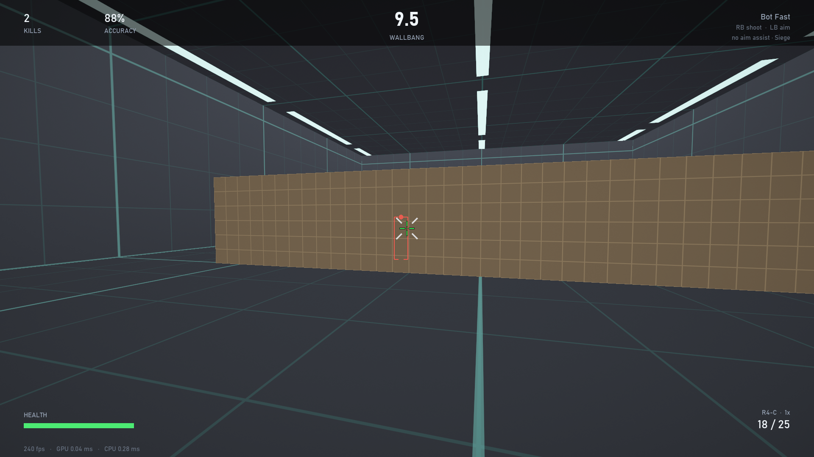

Dummies in orange shoot back, as on the Call of Duty track, and you hear them
coming. Markers through walls are a drill's way of giving you what sound and
drones give you in the game.

### How close is it to the real game?

| | Where it comes from |
|---|---|
| Damage, fire rate, magazine, drop-off, ADS times, attachments, health, limb damage, headshots, ADS walking speed | The game: Ubisoft's designer's notes, and a community sheet measured in the game's shooting range and updated for Y11S3.1 |
| Mouse sensitivity, ADS sensitivity, field of view, sight zoom | The game: Ubisoft's own formulas (the degrees-per-count constant is the community's, and every calculator agrees on it) |
| Damage through a soft wall, walking speeds | Community measurements; the sources disagree by a few percent |
| Recoil patterns, lean distance / tilt / time, eye heights, crouch speed, reload times | **Tuned.** None of it is published. Recoil follows each gun's described character |
| Controller turn speed | **Yours**, from the spin test - or a placeholder until you do it |
| Controller stick curve, acceleration | **Not modelled.** Never measured by anyone |

## One sensitivity for every track

*Settings > Sensitivity across tracks* has two rows, one for a controller and one
for the mouse:

- **Each track's own** (the default): the three tracks use their own settings.
- **Core track / Call of Duty track / Siege track**: every track turns the way
  that track's settings say.

So the mouse can follow the Core track's centimetres per turn while the
controller follows the Call of Duty track's stick settings - and from then on
that is the sensitivity on all three tracks, for that device.

- **Controller**: the followed track's full-stick speeds, its deadzones and
  response curve, and its ADS speed, all together - a stick is only "the same"
  if all of those are.
- **Mouse**: the followed track's distance per turn from the hip, and its ADS
  rule applied to each track's own zoom.
- **Only how the view turns is shared.** Field of view, zoom, guns and recoil
  stay each track's own. So does aim assist: the Call of Duty track still has
  it on a controller, the other two still have none.
- The other tracks' sensitivity settings are kept, marked "not in use", and
  come back if you switch to *Each track's own*.
- **Fingerprints follow.** A track that follows another logs that track's
  settings, so its runs are compared only with runs played on the same real
  sensitivity. The followed track's own history is untouched.
- The **sensitivity finder** searches whichever settings are in use, in their
  own units, and saves its result there.

## Mouse and keyboard

Pick the **Mouse & keyboard** profile under *Input device* - or just click: a
left click in the menus selects it, and pressing a button on a controller selects
that controller again. One device per run: whichever profile a run starts on is
the only device read until it ends.

| | Default | |
|---|---|---|
| Shoot / Aim | left click / right click | any mouse button (1-5) or key, under *Binds* |
| Move (Call of Duty and Siege tracks) | W A S D | rebindable; eight directions at full walking speed |
| Lean / crouch / reload (Siege track) | Q and E / C / R | rebindable; leaning is held, crouch is a toggle |
| Pause | Esc | Enter resumes, X restarts, Esc again quits |
| Menus | arrows or W A S D, Enter, Esc, or the mouse | point and click, right click backs out, the wheel scrolls; Q / E are the fine steps; type numbers straight into Settings |

**DPI**

Windows has no way to ask a mouse for its DPI - a mouse reports counts and never
says how many make an inch - so no program can detect it for every mouse. What
this one does:

- **Razer mice are asked directly.** Razer's own protocol has a "what is your
  DPI?" question (documented by the OpenRazer project); the app asks it at start
  and every few seconds while you are in the menus on the mouse profile, and
  keeps *Mouse DPI* equal to the answer - so it follows the mouse's DPI button
  too. It only ever asks; it sends nothing that changes the mouse. Checked on a
  DeathAdder V2. Never during a run.
- **Any other mouse: measure it.** *Settings > Read or measure DPI* has a ruler
  test - hold left click, slide the mouse a known distance, let go, three times -
  and works out the DPI from the counts. Mice are set in round steps, so a
  measurement within 6% of a common setting is taken as that setting.
- Setting the DPI yourself (or using a measured value) turns the automatic
  reading off, so it is not read back over you.

**Sensitivity**

- *Core track*: **centimetres per full turn** (default 30) with your mouse's DPI.
  That is the number that means the same thing in every game.
- *Siege track*: the game's own slider and multiplier unit - see "Siege track".
- *Call of Duty track*: the game's own **mouse sensitivity**, **ADS sensitivity
  multiplier** and **monitor distance coefficient**, to copy straight from its
  menu. One count turns the view 0.0066 degrees x sensitivity; through the sights
  that is scaled the way the game's "Relative" mode does it
  (`atan(c * t / zoom) / atan(c * t)`, t = tan of half the vertical field of
  view, c the coefficient, default 1.33). Settings shows what your numbers come
  to in centimetres per turn, from the hip and through the sights.
- No track has aim assist on a mouse. The 19 Call of Duty scenarios that
  give a controller aim assist are the same drills without it; the Siege track
  has none for anybody.

**What is done to keep it fast and exact**

- **Raw Input**, not the Windows pointer: the mouse's own counts, untouched by
  pointer speed or "enhance pointer precision", with no screen edge to stop at.
- **A thread of its own, woken by the device.** It sleeps until the mouse or
  keyboard reports and reads everything pending in one buffered call, so a high
  polling rate costs nothing per message. It is not a polling loop.
- **Every report is time-stamped as it is read** (QueryPerformanceCounter), so a
  click is known to a fraction of a millisecond instead of a 4 ms frame.
- **Reports are replayed in order.** A click is judged where the crosshair was
  *at that click* - movement before it applied, movement after it not yet. At
  240 fps a flick crosses a target inside one frame; "where it ended up when the
  frame finished" would score flick-and-click shots wrongly in both directions.
- **Taken as late as possible**: after the frame-pacing wait, immediately before
  simulating and drawing, like the controller.
- **Nothing in between**: no smoothing, no interpolation, no acceleration, no
  deadzone, no turn-speed cap.
- While a run is live the pointer is hidden and held inside the window; the aim
  never comes from the pointer, so that changes nothing.
- For the least display lag as well, set *Frame cap* above your refresh rate or
  to *Uncapped* and leave V-Sync off: each frame then shows input that is a
  fraction of a millisecond old instead of up to one refresh old.

The overlay shows the mouse's measured report rate while it moves, and each run
logs it together with how old the newest report was when a frame used it.

**How aim assist is kept out**

A mouse run is built with a stand-in (`codkit.NoAssist`) where a controller run
has its aim assist: there is no strength, slowdown or rotation to switch on, and
anything that asked for some would raise an error instead of quietly helping.
The controller is not read during a mouse run, so its assist cannot be borrowed
by keeping a thumb on a stick; and the mouse is not read during a controller
run. Mouse runs also carry their own settings fingerprint, so they are never
averaged in with controller runs. `tests/check_mouse.py` checks all of this in
every one of the 27 scenarios.

**Not available on a mouse**: *Stick Snap* (it times a thumbstick), the
Controller lab and the guided comparison (both are about controllers). The
sensitivity finder has a mouse search of its own - see "On a mouse" below.

## Sensitivity finder

One round is ten 20-second blocks (about four minutes): five values spread around
your current one, played in a shuffled order and then the same order reversed, so
warming up or tiring cannot favour any value. You are not told which block is
which. A curve is fitted through your scores and its peak is the answer.

- **Stick sensitivity** first. The drill is big turns onto dummies beside and
  behind you. While it varies, the ADS multiplier is counter-adjusted so your ADS
  speed stays exactly what it was - otherwise two things would change at once.
- **ADS multiplier** second, at the stick sensitivity you settled on. The drill
  is picking up and tracking a strafing dummy through the sights.
- Each further round closes in: the spread narrows around the peak. If the peak
  is at the edge of what was tested, the next round reaches past that edge
  instead.
- **Play at least two rounds before applying.** The first round only finds the
  neighbourhood - five widely spaced values, twice each - and its result is
  labelled *rough* on screen. (A real one-round ADS result here put the best at
  1.00 while both of the highest-scoring blocks were at 1.22; one round cannot
  tell that from luck.)
- **X** applies the result to the Call of Duty settings. Every block is saved to
  `logs/sens.jsonl`.
- **Sessions add up.** Come back another day and both searches carry on from
  where they had got to - see "Sessions add up" below.
- **LB / RB switches to the Siege track's drills**: the same two drills with a
  Siege gun, Siege's distances and **no aim assist**. That matters on a
  controller - slowdown lets a thumb control more speed, so the sensitivity you
  play best at with aim assist is not the one you play best at without it. On
  Siege's drills the finder searches (and X applies to) Siege's own settings,
  unless your sensitivity follows another track.
- **The ADS answer is kept as a speed, not just a number.** A multiplier of 1.00
  means one turn speed at stick sensitivity 1.95 and a 15% slower one at 1.65,
  and what the drill tested was the speed. So after you apply an ADS result,
  changing stick sensitivity in Settings moves the multiplier to keep that speed
  (the row shows *held*), within the game's 0.10 - 2.00. Setting the multiplier
  yourself lets go of it.

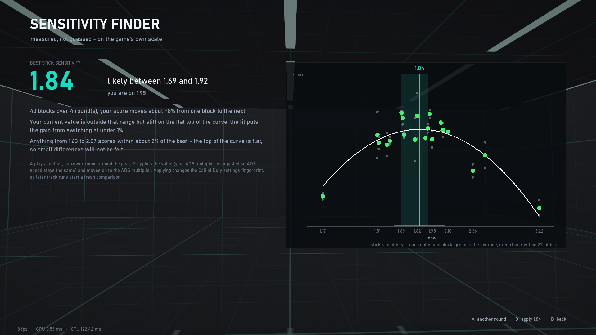

*(The picture uses simulated scores, not a real player's.)*

Read the result as three things:

- the **best value**, to 0.01 on the game's scale;
- **"likely between"** - the range the data really supports. It comes from
  re-fitting on resampled blocks and from fitting a second, lopsided curve, so it
  stays honest when too-fast costs you more than too-slow or the other way round;
- **"anything from A to B scores within about 2%"** - the flat top of the curve.

That last line is the important one. Performance is flat near its peak, so no
method can pin "the perfect number" to two decimals, and none needs to: inside
that band you will not feel the difference. In simulation, with scores moving 8%
from block to block, the best value lands within 2-3% of the truth after two
rounds when the curve is symmetric or flat-topped (5-8% when it is strongly
lopsided), and the stated range holds the truth about four times in five; expect
a range of roughly +/-10% after two rounds, narrowing slowly with more.

Results are per controller - a lighter or shorter stick can peak somewhere else -
and they are found with this trainer's weaker aim assist, so treat the number as
a well-founded starting point and confirm it in the game.

### Sessions add up

The finder does not start from nothing each time you open it. Every block you
have ever played under the same conditions is already counted, for stick
sensitivity and for ADS alike, and the next round is planned from where the
search had got to. A round whenever you sit down keeps narrowing the answer; the
first screen says how many blocks and sessions it is building on, and since when.

- **"The same conditions"** are the things that change what a value means: the
  controller (or mouse profile), whose drills (Call of Duty's or Siege's), the
  aim-assist style, the response curve, deadzones and turn-speed calibration -
  on a mouse the DPI and field of view, on Siege's drills the gun and sight.
  Change one and that is a search of its own; change it back and the old
  sessions count again.
- **A good day cannot pass for a better sensitivity.** You do not score the same
  every day, and the days do not test the same values - each closes in further
  than the last - so raw scores thrown together would read "I was sharper on
  Thursday" as "Thursday's values are better". Each session therefore gets a
  level of its own in the fit (and its own warm-up drift): the curve is fitted to
  how a session's blocks compare with each other, never to how one day compares
  with another. On the chart every block is drawn with its session's level taken
  out. In simulation, with days 30% apart in level, nine results in ten land
  within 4% of the truth this way and within 13% with raw scores thrown together;
  and one round on each of four days pins the answer down tighter than two
  rounds in one sitting (a range about 20% wide against about 26%).
- **ADS blocks are stacked by speed, not by number.** A multiplier only means a
  turn speed at the stick sensitivity it was played at. Each ADS block is logged
  with the speed through the sights it really tested (degrees per second on a
  controller, centimetres per turn on a mouse) and is placed on today's scale by
  that - so applying a new stick sensitivity moves the earlier ADS blocks to the
  multipliers that give their speeds now, instead of mixing two meanings of
  "1.00". A block whose speed today's scale cannot reach is left out, and the
  first screen says how many.
- **Y on the first screen starts the selected search over** (it asks first). Use
  it when something outside the settings has changed - a new grip, new stick
  caps, weeks away. Nothing is deleted: a line in `logs/sens.jsonl` marks the
  spot, and blocks before it are no longer counted.

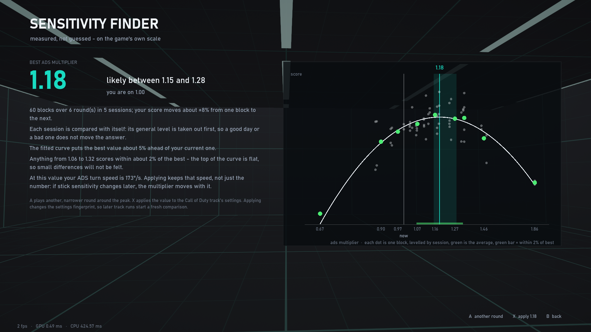

*(Simulated scores: five sessions on days that differ in level by about 18%,
with the stick sensitivity changed after the second.)*

### On a mouse

Open the finder with the mouse-and-keyboard profile active and it runs the same
search for a mouse's two numbers instead - same drills, same blind mirrored
rounds, same curve fit, and no aim assist in any block.

- **Mouse sensitivity** first, searched as **centimetres of mouse travel per
  full turn**. That is the one unit that means the same thing in every game, so
  a result is not tied to this program. *Fewer centimetres is faster*, and the
  chart runs from fast on the left to slow on the right. The result screen also
  gives the number on Call of Duty's own mouse scale for your DPI.
- While it varies, the ADS multiplier is left alone. On a mouse it is a ratio to
  the hip sensitivity, so the sights speed up and slow down along with it - as
  they do in the game. (A controller's hip pass does the opposite and holds ADS
  speed still, because there the two are separate speeds.)
- **ADS multiplier** second: the Call of Duty track's mouse ADS multiplier, at
  the sensitivity you settled on and your monitor distance coefficient.
- **X on a sensitivity result sets both tracks**: the Core track's centimetres
  per turn, and the Call of Duty track's mouse sensitivity to the same distance
  (to the nearest 0.01 on its scale). X on an ADS result sets the Call of Duty
  multiplier only - the Core track's ADS sensitivity belongs to a different
  zoom and stays where you put it.
- **Where it starts.** From the sensitivity you are on. If your two tracks are
  set differently, that is the one your most recent mouse run was played with,
  and the first screen says so.
- The centimetres are only as right as the **Mouse DPI** in Settings. Get that
  wrong and the search still finds the same physical sensitivity - only the
  label on it is off.
- Mouse and controller sessions are kept apart in `logs/sens.jsonl`, and
  switching device while the finder is open starts it over for the new one.

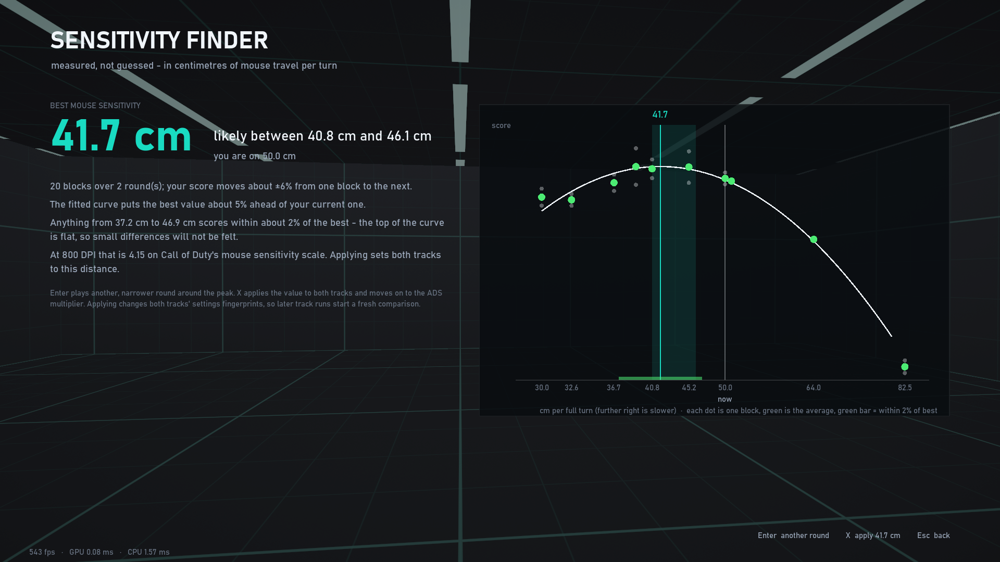

*(Simulated scores again: a made-up hand that peaks at 41 cm.)*

## Progress and training

Everything else compares controllers. This compares you with yourself, on the
active controller:

- a line through **every run** of each scenario, with your best, your last run
  and the average of your last three. Runs made with the current settings are
  bright and are the only ones counted; runs with other settings stay on the
  chart in grey, so a change of sensitivity or a new recoil model does not wipe
  your history from view;
- a **trend** - improving, steady or slipping - from your last three runs against
  the ones before. It needs five runs with the current settings, because three
  runs against one says nothing, and anything inside 3% is called steady;
- **Train my weakest five**: a playlist of the five scenarios with the lowest
  share of shots on target (time on target for the Core tracking drills) over
  your last three runs, worked out again after every run.

"Weakest" needs care. There are no other players' scores in here, so nothing can
say you are bad at a drill, and some drills are simply harder than others. What
the list does say is where the largest share of your bullets is going astray,
which is where practice gives the most back. The two reaction drills have no hit
rate and are never in it.

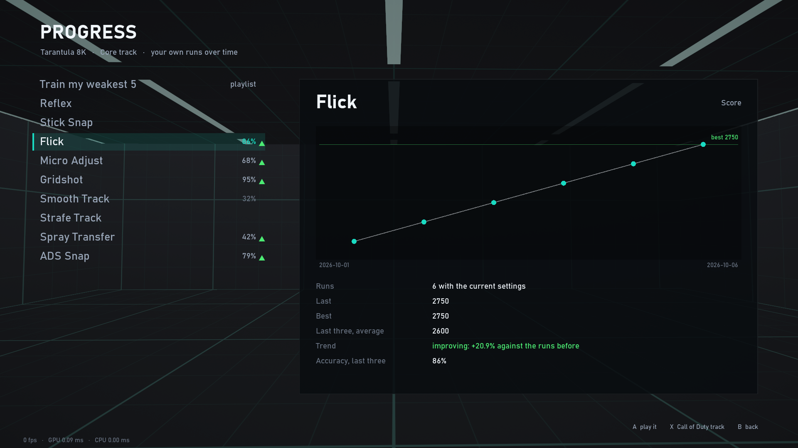

*(The picture uses made-up runs.)*

## Guided comparison

The first real comparison made with this app ended in a tie that was mostly an
artefact: scores climbed all evening whichever pad was in hand, so order decided
it. The guided comparison removes that:

- **Five scenarios**, the same every time (Core: Flick, Micro Adjust, Gridshot,
  Smooth Track, Strafe Track; Call of Duty: Snap Shot, Strafe Spray, Recoil Hold,
  Sticky Track, Mirror Strafe), so a pass takes about five minutes at 45 s rounds.
- **A warm-up pass** that is played, logged, and left out of every comparison.
- Then **blocks of four passes in A - B - B - A order** (the next block is
  B - A - A - B). Whatever drifts steadily while you play - warming up, tiring,
  learning the drill - lands equally on both pads and cancels out of the
  difference. The screen says which pad to pick up and will not start a pass on
  the wrong one.
- **The first pad is asked for twice in a row**: once for the warm-up, once for
  pass 1. That is the plan, not the screen being stuck - the hand-over screen
  shows the whole block with the warm-up in it and says so. If you have just
  been playing, **X** skips the warm-up.
- **Stopping part-way loses nothing.** A block left unfinished can be carried on
  from the same menu entry for three hours (with a fresh warm-up if you were
  away more than twenty minutes); after that it is a different sitting and a
  new block starts.
- **The verdict** pairs the two pads inside each block, scenario by scenario, and
  averages those pairs. It is called *a real difference* only at p < 0.05 **and**
  after at least two blocks - one sitting is one sitting, however lopsided.
  Otherwise it says *leaning* or *inside run-to-run noise*, and estimates how
  many more blocks a gap of that size would need. Past twenty it says what that
  means: for your hands, on that track, the two pads perform the same.

Blocks add up across days for as long as the settings fingerprint stays the same.

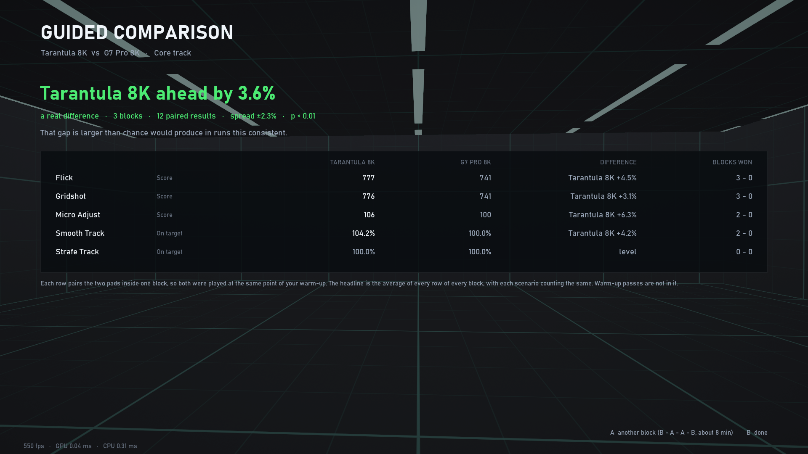

*(The picture uses made-up runs, not a real result.)*

## Fair comparisons

Aim scores move 5-10% from one run to the next on the *same* controller, so one
good run proves nothing. AimTuner is built around that:

- **Alternate pads** (A, B, B, A ...) after a warm-up. You improve as you play;
  if you do all of pad A and then all of pad B, B gets the credit for your warm-up.
  *Guided comparison* does exactly this for you.
- A difference is labelled **clear** only when Welch's t-test gives p < 0.05 with
  at least four runs per pad. Otherwise it says *leaning*, *within noise* or
  *need more runs* - and means it.
- Every setting that changes difficulty feeds a 6-character **settings
  fingerprint**, and runs are only compared with runs that share it. The two
  tracks have **separate fingerprints**: changing your Call of Duty sensitivity,
  curve, deadzones, calibration or aim-assist style starts a fresh comparison on
  that track and leaves the Core track's history alone, and the other way round.
  Trigger actuation counts only while Shoot or Aim is bound to a trigger.
- **Binds are a comparison dimension, not a setting.** Run the same pad on RB/LB
  and on RT/LT and you get two columns.
- Each run records the pad's USB id, measured report rate, frame-rate stats and
  whether you paused, and `analyze.py` warns when any of that looks off (a run
  under the wrong profile, frame hitches, mixed settings).
- For "which pad is better", the **Core track** is the fair test: nothing helps
  you aim there. Call of Duty track runs are compared the same way, per pad, but
  they answer a different question - which pad you play that game's mechanics
  better on.

## Logs

```
logs/runs.jsonl                one line per finished run: who, which track, what, settings, stats
logs/runs/<run_id>_<pad>.json  the same record + every per-target event
                               (and a 20 Hz error trace for tracking runs)
logs/lab.jsonl                 Controller lab results, one line per test
logs/sens.jsonl                Sensitivity finder: one line per block
logs/endless.jsonl             endless runs (practice): the same record with "endless": true
logs/captures/<run_id>.npz     a run frame by frame, for its replay; <run_id>.ghost.npz the ghost's (newest 60 kept)
```

A run record looks like:

```json
{"run_id": "20261005-142233-flick", "controller": "G7 Pro 8K", "track": "core", "scenario": "flick",
 "binds": {"shoot": "RB", "ads": "LB"}, "fingerprint": "322560",
 "device": {"backend": "xinput", "id": "3537:103D"},
 "input": {"report_hz_median": 7990, "poll_hz": 1990, "timestamp_resolution_ms": 0.251},
 "display": {"width": 3840, "height": 2160, "fps_avg": 240.0, "fps_1pct_low": 238.6},
 "stats": {"score": 2140, "kills": 23, "accuracy_pct": 88.5, "ttk_median_ms": 912.0,
           "react_median_ms": 231.0, "overshoot_per_kill": 0.35, "path_eff_pct": 81.2}}
```

Call of Duty track records also carry the sensitivity, curve, deadzones and
aim-assist style used, plus `strafe_pct`, `aa_avg_pct`, `aa_full_pct` and
`aa_lost_to` (seconds of fight time lost to each reason). Runs under Coach rules
add `coach`: the share of each habit (`track`, `strafe`, `centre`) while a target
was in the bubble, and `focus`, the weakest of them. Runs played in a guided
comparison carry `duel`: the session, block and pass they belong to, and whether
the pass was the warm-up.

`python analyze.py` prints every metric side by side with the verdicts, one
section per track, followed by the paired verdict of any guided comparison. `--track core|cod` limits it to one, `--runs` lists individual
runs, `--last N` / `--since DATE` narrow the window, `--lab` shows the Controller
lab results, `--all` includes runs made with other settings, `--json` is for
tooling. Aborted or restarted runs are never logged, and sensitivity-finder
blocks are never mixed into the run history.

## How it stays fast

The target was 4K at 240 Hz from an interpreted language, so the frame is built
to cost almost nothing on the CPU and to let the GPU do all the drawing:

- **Three draw calls per frame.** (1) One full-screen triangle whose pixel shader
  ray-casts the arena, draws the anti-aliased grid and lights the room from every
  target - glow, drop shadows and (optionally) glossy floor reflections are all
  analytic, per pixel. On the Call of Duty track the same pass also ray-casts up to 16 cover
  blocks and up to 4 smoke clouds. (2) Instanced *impostors*: each target sphere
  and each dummy's body capsule is a quad whose shader solves the ray
  intersection, so they are perfectly round with analytic edge anti-aliasing at
  any resolution, and are hidden correctly behind cover and inside smoke without
  a depth buffer. (3) One batched triangle list for all text and HUD.
- **No depth buffer, no MSAA, no post-process passes** - nothing needs them, and
  at 4K they would be hundreds of MB of framebuffer to clear and swap.
- **Input on its own thread.** XInput is polled at ~2 kHz and each change is
  stamped with QueryPerformanceCounter, so reaction and time-to-kill figures have
  +/-0.25 ms resolution instead of being rounded to a 4 ms frame.
- **Late input sampling.** The loop waits for its frame slot first and reads the
  stick last, right before simulating and drawing.
- Garbage collection is off during a run; the frame limiter sleeps and then spins
  for the last fraction of a millisecond.

Measured on this machine (RTX 5070 Ti, Core Ultra 9 285K) with `run.bat --bench`,
which renders offscreen at 3840x2160 and waits for the GPU to finish every frame:

| Scene | Graphics | Frame time | Throughput | GPU time |
|---|---|---|---|---|
| Core track | High | 0.41 ms | ~2,450 fps | 0.19 ms |
| Core track | High + floor reflections | 0.45 ms | ~2,250 fps | 0.22 ms |
| Core track | Low | 0.36 ms | ~2,770 fps | 0.13 ms |
| Call of Duty track, cover blocks | High | 0.47 ms | ~2,140 fps | 0.21 ms |
| Call of Duty track, cover blocks | High + floor reflections | 0.53 ms | ~1,880 fps | 0.28 ms |
| Call of Duty track, smoke | High | 0.41 ms | ~2,460 fps | 0.17 ms |
| Call of Duty track, cover blocks | Low | 0.43 ms | ~2,310 fps | 0.19 ms |

High adds the targets' glow and drop shadows. **Floor reflections are a separate
setting and are off by default**: a glossy floor mirrors the ceiling lights and
every target, and those mirrored copies slide across the lower half of the
screen as you turn - exactly where an aim trainer should have nothing moving.

So a 240 Hz frame (4.17 ms) uses about an eighth of what is available even in
the heaviest scene. On the real display, fullscreen 3840x2160 at 240 Hz measured
240.0 fps average with the 99th-percentile frame at 4.27 ms, 0.4 ms of CPU and
0.3 ms of GPU per frame (`python app.py --exit-after 7` prints these). The
performance overlay shows live FPS, GPU and CPU time per frame and the pad's
report rate, and every run log stores its own frame-rate statistics.

## Honest limitations

- **Reaction times include your display and system latency.** Absolute numbers
  will be higher than on a dedicated reaction tester; the *difference* between
  two pads on the same PC is what is meaningful.
- **The Core track's response curves are generic** (linear, squared, S-curve)
  and it has no aim assist. A pad that wins there is the pad you control better
  raw - usually, but not certainly, the one you will also play better with
  in-game.
- **The Call of Duty track is a model, not the game.** See "How close is it to
  the real game?" for exactly which parts are measured, which are taken from
  other people's measurements, and which are tuned or assumed. Aim assist is
  weaker than the real thing on purpose.
- **The Siege track is a model too, and its recoil is the least certain part of
  it.** The guns' numbers are the game's; their recoil patterns are built from
  descriptions because no numbers exist. If a gun here kicks differently from
  the one you know, the game is right. Controller turn speed is a placeholder
  until you do the spin test, and Siege's stick curve and acceleration are not
  reproduced at all. The Siege track has been played by bots on both devices,
  not yet by a person.
- **DPI can only be read from Razer mice**, and that was checked on one model (a
  DeathAdder V2). Other Razer mice use the same question; if one does not answer,
  the setting is left alone and the ruler test still works.
- **The sensitivity finder gives a range, not a certainty**, and its result is
  for this trainer's conditions.
- **Mouse input is proven on real hardware up to 1,000 Hz, not above.** The first
  real session (nine runs, a mouse reporting at up to 1,000 Hz) logged every
  report read on its own (`paired_pct` 0.0) and the newest report a median
  0.7 - 1.2 ms old when a frame used it. Faster polling (2 - 8 kHz) has only been
  tried with injected reports, and Windows itself hands *injected* reports over
  late when they come less than about 4 ms apart (seen before they reach this
  program), so that case could not be proved that way. Each mouse run logs
  `paired_pct` - the share of reports that were read together with another -
  which will show it: a few percent is normal at 4-8 kHz; a third or more at
  1 kHz would not be.
- **The mouse sensitivity finder has been played by a bot, not yet by a person.**
  The search, the centimetres (measured on the turning view) and what gets
  applied are all checked; whether its drills separate a real hand's good
  sensitivities from its bad ones as cleanly as they do a thumb's is not known
  until someone plays a few rounds.
- **Not every panel is clickable.** Menu lines and the footer hints are; the
  results tables, charts and the replay timeline are still driven by keys.
- **"Weakest" is relative to nothing but you.** The training playlist ranks by
  your own hit rate; it has no other players to compare you with.
- **The guided comparison assumes steady drift.** A-B-B-A cancels anything that
  changes evenly while you play. It cannot cancel a pad you have simply used for
  years against one you unboxed today - that is a real difference in you, and it
  will show up as a difference between the pads.
- **Report rate is observed, not claimed.** It is the XInput packet counter's rate
  of change, and that counter only moves when the pad's state changes - so a pad
  lying still under-reads (6,500-7,900 Hz at rest on an 8K pad here). The overlay
  and the logs therefore show the recent peak; move a stick to see the real figure.
- **The Controller lab sees what Windows sees.** It cannot measure the delay
  between a physical press and the report, and a pad that sends duplicate reports
  faster than its sensor updates will show the sensor's rate, not the USB rate.
- **Non-XInput pads** (a controller left in Switch or DS4 mode) are read through
  GLFW once per frame, so their timestamps are frame-quantised (about +/-2 ms at
  240 fps) and the Controller lab is unavailable. Use XInput mode.
- V-Sync is off by default for the lowest latency. Without G-Sync/VRR that means
  some tearing; turn V-Sync on in Settings if it bothers you.

## Layout

```
app.py                launcher / CLI
analyze.py            log analysis
build_exe.py          builds AimTuner.exe + _internal/ with PyInstaller (build_exe.bat runs it)
aimtuner/
  app.py              window, main loop, frame pacing
  gfx.py              renderer (font atlas, UI batch, world pass)
  shaders.py          the GLSL
  pad.py              XInput thread, capture mode, GLFW fallback, deadzone + curves
  mouse.py            Raw Input thread for mouse and keyboard, report parser, binds
  dpi.py              mouse DPI: the question a Razer mouse can be asked, and the ruler-test maths
  dpiscreen.py        the DPI screen
  sens.py             one sensitivity for every track: each track's settings as a turn response
  game.py             one run: camera, clock, HUD, run record
  scenarios.py        the nine Core scenarios and their metrics
  codkit.py           Call of Duty kit: sensitivity, curves, aim assist, rifle, movement, dummies
  codscn.py           the 27 Call of Duty scenarios
  r6kit.py            Siege kit: guns and recoil, damage, soft walls, leaning, sensitivity - and no aim assist
  r6scn.py            the 24 Siege scenarios
  tracks.py           which scenarios belong to which track
  lab.py              Controller lab analysis (pure functions over captured reports)
  labscreen.py        Controller lab screen
  sensfit.py          curve fit and search plan behind the sensitivity finder
  sensfinder.py       Sensitivity finder screen
  stats.py            log I/O, grouping, Welch's t-test, verdicts, progress and paired-comparison maths
  progress.py         Progress and training screen
  duel.py             Guided comparison screen
  screens.py          menus
  uikit.py            shared menu widgets
  sound.py            synthesized feedback sounds
  icon.py             the crosshair icon (window, taskbar, AimTuner.exe)
  capture.py          records a run frame by frame (view, inputs, body, targets, what was drawn) for replays
  ghost.py            the ghost: the run's targets replayed at its pace, and a strong human's aim through the game's code
  engage.py           where each target's time went (reaction, first movement, corrections, shot, kill), you vs the ghost
  replay.py           the replay with the ghost, and the every-target screen
  bot.py              synthetic player for --selftest (never active otherwise)
tests/
  run_checks.py       runs the check_*.py scripts below and says which passed
  check_codkit.py     calibration, response curves, damage, the recoil pattern, aim-assist rules, the strafe-by test
  check_training.py   progress, the weakest-five playlist and the guided comparison: the maths, then both screens
  check_mouse.py      mouse and keyboard: report parser, sensitivity maths, no aim assist anywhere, runs on both
                      tracks; nudges the real pointer one count each way to prove raw reports arrive
  check_cues.py       the warning tone: the sound files, and that armed dummies (only) play it from the right side
  check_lab.py        Controller lab maths against synthetic pads of known properties
  check_lab_screen.py the Controller lab screen, driven by a synthetic 8 kHz pad
  check_sensfit.py    does the sensitivity fit recover a known optimum from noisy blocks - one session's, or several days'?
  check_sensfinder.py the sensitivity finder, played end to end by a bot
  check_sensfinder_mouse.py  the same on a mouse: centimetres per turn measured on the turning view, both
                      tracks set on apply, no aim assist in any block
  check_flows.py      menus, pause, playlists, settings, fingerprints
  check_r6.py         the Siege track: its maths against the game's published numbers, that nothing in it
                      assists anyone's aim, and its guns, walls, leaning and reloading in the real loop
  check_sens.py       one sensitivity for every track: the maths, the fingerprints, real runs on all three
                      tracks, the finder and the Settings screen
  check_dpi.py        the Razer DPI question and how its answer is vetted, the ruler test, the DPI screen
                      (talks to no hardware)
  check_endless.py    endless mode: all 60 scenarios outlast the round length (Reflex and Stick Snap their
                      trial counts), pause / finish / restart, and nothing reaches runs.jsonl
  check_ghost.py      captures, the ghost (same targets, same order, your body, no assist where you had none,
                      never faster than a hand), its numbers, the advice, and the replay / every-target screens
```

`python app.py --selftest` plays every scenario on all three tracks with two
differently-skilled bots on a scratch config and log directory, without opening
a window - a full end-to-end check of input path, scenarios, logging and
comparison maths. `--only core`, `--only cod`, `--only r6` or a comma-separated
list of scenario ids narrows it, and `--mouse` plays it on a virtual mouse.
`python tests/run_checks.py` runs the rest (about fifteen
minutes); nothing in either touches your real config or logs. One of them,
`check_mouse.py`, moves the real pointer one count right and one count left a
few times to prove raw reports arrive (set `AIMTUNER_NO_NUDGE=1` to skip that).

## Sources for the Call of Duty model

- Official patch notes: [Black Ops 7 pre-season](https://www.callofduty.com/patchnotes/2025/11/call-of-duty-black-ops-7-preseason-patch-notes)
  (rotational aim assist changes of 12 and 21 November 2025),
  [Black Ops 7 Season 01](https://www.callofduty.com/patchnotes/2025/12/call-of-duty-black-ops-7-season-01-patch-notes)
  (M15 MOD 0 damage ranges and movement speeds),
  [Black Ops 6 Season 01](https://www.callofduty.com/patchnotes/2024/11/call-of-duty-black-ops-6-season-01-patch-notes)
  (the 0.10 - 4.00 sensitivity scale).
- TheXclusiveAce's measurements: [how aim assist works](https://www.youtube.com/watch?v=obaY2fK95Sg),
  [aim assist by range](https://www.youtube.com/watch?v=jcE4afDM0kU),
  [Black Ops 6 aim assist and sensitivity](https://www.youtube.com/watch?v=U0G7iyq3Gbk),
  [Black Ops 7 aim assist](https://www.youtube.com/watch?v=4G-28DtYXXs),
  [response curves](https://www.youtube.com/watch?v=LJIZ1oqOaPQ) (showing u/AntonUncut's measured chart).
- Stick-input thresholds and the on-screen bubble: [hecksmith](https://www.youtube.com/watch?v=frjx63T5FQU).
- Modern Warfare 4 (beta): [official beta patch notes](https://www.callofduty.com/patchnotes/2026/08/call-of-duty-modern-warfare-4-beta-patch-notes)
  (28 August: aim assist reduced, "not the exact tuning we want"; 1 September: further changes in progress);
  TheXclusiveAce on [the first weekend](https://www.youtube.com/watch?v=lUMnMdi7URI) (it appeared identical to
  Modern Warfare II's) and on [the developers' September update](https://www.youtube.com/watch?v=3nw1L_wzmco)
  (inputs about even at 5-15 m, controllers slightly ahead closer in);
  [Drift0r](https://www.youtube.com/watch?v=hhZ4-iywij4) comparing footage from both weekends.
- Rifle handling numbers: [CODMunity, M15 MOD 0](https://codmunity.gg/weapon/bo7/m15-mod-0).
- Mouse: 0.0066 degrees per count per unit of sensitivity, from third-party converters
  ([Recharge](https://www.recharge.com/blog/en-ca//mouse-sensitivity-converter-calculator-for-23-fps-games),
  [West Games](https://west-games.com/cm-per-360-calculator/)); the monitor distance coefficient and what
  1.33 / 1.78 / 0 mean, from the mouse-sensitivity.com forums
  ([choosing a coefficient](https://mouse-sensitivity.com/forums/topic/7303-what-monitor-distance-coefficient-should-i-use),
  [Modern Warfare thread](https://mouse-sensitivity.com/forums/topic/6164-call-of-duty-modern-warfare-2019/page/12));
  the arctan form of the relative ADS formula as written out in an
  [EA forum post](https://forums.ea.com/discussions/apex-legends-feedback-en/better-ads-sensitivity-system/8415533).
  None of these is an Activision source.

Numbers read off charts and videos are approximate, and where sources disagreed
or said nothing the README table above says so.

## Sources for the Siege model

- Sensitivity and field of view, from Ubisoft:
  [FOV and input sensitivity](https://www.ubisoft.com/en-us/game/rainbow-six/siege/news-updates/6kY6b5JByBY3P6vQWWinla/fov-and-input-sensitivity)
  (the hip-fire formula, the vertical 60 - 90 FOV slider),
  [guide to ADS sensitivity in Y5S3](https://www.ubisoft.com/en-us/game/rainbow-six/siege/news-updates/3IMlDGlaRFgdvQNq3BOSFv/guide-to-ads-sensitivity-in-y5s3)
  (the ADS formula and each sight's share of the field of view). The 0.2865
  degrees-per-count constant is the community calculators'
  ([senslab](https://senslab.pro/sensitivity/r6siege-to-cs2),
  [sensconverter](https://sensconverter.app/r6-siege-sensitivity-converter/)).
- Guns: a community sheet measured in the game's shooting range and updated for Y11S3.1
  ([hanslhansl](https://github.com/hanslhansl/rainbow-six-siege-weapon-statistics)),
  cross-checked against the [Rainbow Six wiki](https://rainbowsix.fandom.com/wiki/R4-C).
- Health, damage drop-off and the R4-C / AK-12 recoil notes:
  [Y6S3 designer's notes](https://www.ubisoft.com/en-us/game/rainbow-six/siege/news-updates/2zsUnVBdSsc10rirkPl1K5/y6s3-preseason-designers-notes),
  [Y6S2](https://www.ubisoft.com/en-us/game/rainbow-six/siege/news-updates/76KxHcLFOo2PdhSS4t1HmZ/y6s2-preseason-designers-notes).
  Recoil growing through a burst:
  [Y7S3](https://www.ubisoft.com/en-us/game/rainbow-six/siege/news-updates/2vKaDckg5VPV1ViA4p8KM/y7s3-preseason-designers-notes).
  ADS times, sights and grips:
  [Y9S1](https://www.ubisoft.com/en-us/game/rainbow-six/siege/news-updates/3jBlCdtRBQx2sCjmY2umNu/y9s1-designers-notes).
  Muzzle brake and compensator: [Commanding Force](https://www.ubisoft.com/en-us/game/rainbow-six/siege/game-info/seasons/commandingforce).
  ADS walking speed: [Y7S4](https://www.ubisoft.com/en-us/game/rainbow-six/siege/news-updates/1ijmpKD6RrqMiD5VrEqt1i/y7s4-preseason-designers-notes).
  Limb damage: [the limb penetration dev blog](https://www.ubisoft.com/en-us/game/rainbow-six/siege/news-updates/3JoP5bWperGVXX3N0nNHlM/dev-blog-limb-penetration-system)
  and [Y10S4.1](https://www.ubisoft.com/en-gb/game/rainbow-six/siege/news-updates/3aYq6D0VHo1HJ5ZNfLtiNs/y10s41-patch-notes).
- Each gun's recoil character: the Rainbow Six wiki's weapon pages and
  [Namu Wiki](https://en.namu.wiki/w/%EB%A0%88%EC%9D%B8%EB%B3%B4%EC%9A%B0%20%EC%8B%9D%EC%8A%A4%20%EC%8B%9C%EC%A6%88/%EB%AC%B4%EA%B8%B0) -
  descriptions, not measurements.
- Damage through soft walls: [damagenumbers wiki](https://damagenumbers.wikidot.com/wiki:rainbow-six:siege) (2021, community).
- No aim assist in multiplayer: [Dexerto](https://www.dexerto.com/wikis/rainbow-six/rainbox-six-aim-assist/);
  Ubisoft has no page saying so, the in-game option is only offered against AI.
- The average engagement being 10 m, and what Siege aim practice should cover:
  [Ubisoft's sights dev blog](https://www.ubisoft.com/en-gb/esports/rainbow-six/siege/news-updates/77PNM7F9qztJpYi0WkRxoY/dev-blog-viseurs-et-lunettes-de-la5s3),
  [the Aim Lab Siege routine](https://aimlabs.com/articles/?p=4534).
- Asking a Razer mouse for its DPI: the [OpenRazer](https://github.com/openrazer/openrazer) driver's source.

## Sources for the ghost

- Reaction times: Woods et al. 2015, [Factors influencing the latency of simple reaction time](https://doi.org/10.3389/fnhum.2015.00131);
  Pluss et al. 2020, [Perceptual-motor abilities underlying expertise in esports](https://www.journalofexpertise.org/articles/volume3_issue2/JoE_3_2_Pluss_etal.pdf);
  Gostilovich et al. 2023, [PLOS ONE](https://doi.org/10.1371/journal.pone.0289293).
- Aiming in FPS games: Warburton et al. 2023, [Kinematic markers of skill in first-person shooter video games](https://doi.org/10.1093/pnasnexus/pgad249);
  Boudaoud, Spjut & Kim 2022, [Mouse Sensitivity Effects in First-Person Targeting Tasks](https://arxiv.org/abs/2203.12050);
  Park & Lee 2020, [An Intermittent Click Planning Model](https://arxiv.org/abs/1806.02973);
  Donovan et al. 2022, [Frontiers in Human Neuroscience](https://doi.org/10.3389/fnhum.2022.979293);
  [NVIDIA's aim-trainer latency experiments](https://developer.nvidia.com/blog/improving-player-performance-with-low-latency-as-evident-from-fps-aim-trainer-experiments/).
- Thumbsticks against mice: Natapov, Castellucci & MacKenzie 2009, [ISO 9241-9 evaluation of video game controllers](https://www.yorku.ca/mack/gi2009.html);
  Ramcharitar & Teather 2017, [A Fitts' law evaluation of video game controllers](https://www.csit.carleton.ca/~rteather/pdfs/CHI2017_fitts_game_controllers.pdf);
  Zaranek et al. 2014, [Performance of modern gaming input devices in first-person shooter target acquisition](https://www.csit.carleton.ca/~rteather/pdfs/Game_devices.pdf);
  Klochek & MacKenzie 2006, [Performance measures of game controllers in a three-dimensional environment](https://www.yorku.ca/mack/gi2006.html).
- How an aimed movement is made: Burkitt, Staite, Yeung, Elliott & Lyons, [Effector mass and trajectory optimization](https://researchonline.ljmu.ac.uk/id/eprint/1486/1/Burkitt%20Stylus%20Study%20EBR.pdf);
  Elliott et al. 2020, [review of the two-component model](http://researchonline.ljmu.ac.uk/id/eprint/13520/);
  Roberts et al. 2024, [Experimental Brain Research](https://pmc.ncbi.nlm.nih.gov/articles/PMC10973010/);
  Brenner & Smeets 1997, [Fast responses of the human hand to changes in target position](https://research.vu.nl/en/publications/fast-responses-of-the-human-hand-to-changes-in-target-position/).
- Following a moving target: McRuer & Jex's crossover model, as summarised in [arXiv:2007.10216](https://arxiv.org/abs/2007.10216);
  smooth-pursuit latency, [Frontiers in Systems Neuroscience 2013](https://doi.org/10.3389/fnsys.2013.00004);
  reacting to a change of direction, Kelkkanen et al. 2023, [Advances in Human-Computer Interaction](https://doi.org/10.1155/2023/1563506).
- Not found in any of them (so assumed, and marked [A] above): how fast a thumb moves a stick, how
  players compensate recoil, and how far they lean on aim assist.
